  

# Hi there, I'm Ameya 👋

I'm a Full Stack AI Engineer from Indore, India. I build AI agents, RAG systems and the products around them, from the Next.js frontend all the way to the infra it runs on. I care about the boring parts too: retries, idempotency, locks and audit logs, so the agent does the right thing when something goes wrong.

## What I'm working on

- **[Crolyo](https://github.com/ameya051/crolyo):** a Slack-native support platform. Drop a widget on your site and every chat opens as a Slack thread with real-time two-way sync. A RAG agent answers what it can and hands off to a human in Slack when a question is risky or out of its depth.
- **[Web Memory Agent](https://github.com/ameya051/web-memory-agent):** a chat agent that remembers past conversations and re-checks old answers against the latest web results, with citations.

## Experience

**Full Stack Developer @ Peak Agent AI** · Sep 2025 to Apr 2026
- Shipped autonomous agents that run Meta ad campaigns, with daily spend caps, human approval for big changes and an audit log of every action
- Built the ad generation pipeline on GPT-5 and GPT-Image-1.5, cutting content ideation time by **70%**
- Turned e-commerce pages into ad-ready data with a Playwright + LLM extraction pipeline that works on **50+ storefronts**
- Set up usage-based LLM credit billing on Stripe and rebuilt signup, cutting auth drop-off by **24%**

**Full Stack Engineer Intern @ Infograins Software Solutions** · Jan 2025 to Apr 2025
- Delivered a PDF question-answering platform with an end-to-end RAG pipeline, deployed on AWS EC2

## Tech Stack

**AI/LLM:** AI Agents, RAG, Tool Calling, Hybrid Search, pgvector, OpenAI, Claude, Gemini, OpenRouter, Vercel AI SDK

**Languages:** TypeScript, JavaScript, Python, SQL

**Frontend:** React, Next.js, Tailwind CSS, Shadcn, Zustand, Preact

**Backend:** Node.js, FastAPI, Express.js, Hono.js, Supabase, PostgreSQL, Redis, SQLAlchemy, Pydantic

**Infra & Tools:** AWS (EC2, S3, ECS Fargate), Terraform, Docker, Vercel, Playwright, Stripe, Slack API, Git

## Featured Projects

| Project | Description | Tech Stack |
|---------|-------------|------------|
| [**Crolyo**](https://github.com/ameya051/crolyo) | Slack-native support platform with an embeddable widget and a RAG agent using hybrid full-text + pgvector search | Next.js, TypeScript, Supabase, pgvector, Python, AWS Fargate, Terraform |
| [**Tab AI**](https://github.com/ameya051/tab-expense-bot) | Telegram expense tracker you can text or talk to. A tool-calling agent with 12 tools, voice input and multi-currency support | Python, FastAPI, PostgreSQL, Whisper, Docker |
| [**Web Memory Agent**](https://github.com/ameya051/web-memory-agent) | Chat agent with web search and memory that re-checks past answers and cites what changed | Next.js, Vercel AI SDK, OpenRouter, Exa, PostgreSQL |
| [**AI Finance Tracker**](https://github.com/ameya051/spenz) | Smart expense tracking with AI-powered categorization | Next.js, Hono.js, Inngest, Gemini |
| [**PDF Chat RAG Pipeline**](https://github.com/ameya051/chat-with-pdf) | Upload a PDF and chat with it | Next.js, Express.js, BullMQ, Gemini, Qdrant |
| [**Video Caption Burner**](https://github.com/ameya051/caption-me) | Web app for burning captions/subtitles directly into videos | Next.js, FFmpeg, TypeScript, AWS S3 |

## Let's Connect

- **Website:** [ameyashr.in](https://ameyashr.in)
- **LinkedIn:** [linkedin.com/in/ameyashrivastava](https://linkedin.com/in/ameyashrivastava)
- **Email:** ameyshri051@gmail.com
- **X (Twitter):** [@ameyaidk](https://x.com/ameyaidk)

---

*Always building something. Check out my repositories below* ⬇️
